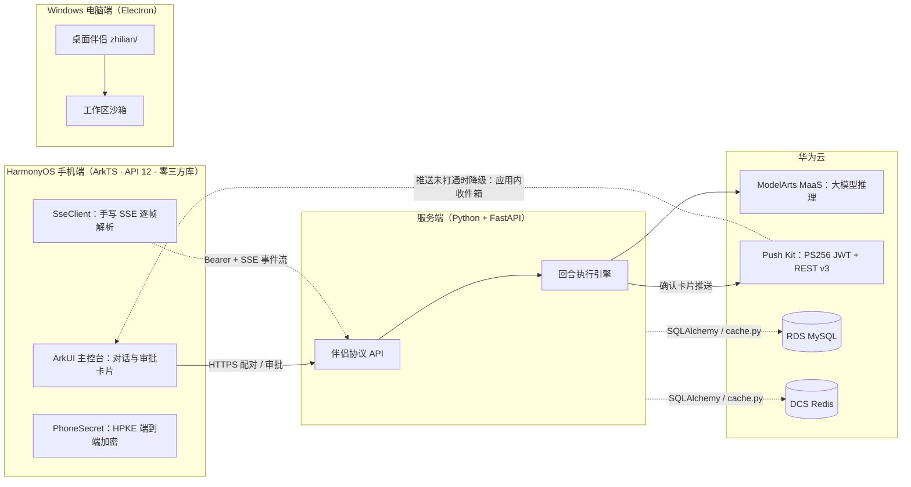

# 联伴——手机确认的电脑智能体

电脑上的队友，手机上的闸门。

联伴是一个「人在回路」的电脑智能体系统：电脑端留在 Windows 机器上干活，HarmonyOS 手机打开的是同一份对话。所有对外的、不可逆的动作——发送、删除、支付、提交、发布、下单、转账、创建日程——电脑端不会自己做完，而是生成确认卡片，经华为 Push Kit 推到手机，等人点了同意才执行。它回答的问题是：**当智能体获得操作真实电脑的能力时，怎样在不砍掉能力的前提下守住安全边界。**

<p align="center">
  
  
  
  
  
</p>

<p align="center">
   43.5">
   19.1">
   5.8">
   7.1">
   24">
   10.33">
   3.12">
   0.115.6">
  
</p>

## 作品概述

联伴按职责配置多个「队友」（bot），各自分管一类事。同一回合对话在三端保持一致：服务端只有一个回合执行核心（写用户消息 → 思考 → 回复 / 确认卡片 / 记忆），网页端点与伴侣端点都汇入同一份逻辑，不存在两个各自为政的客户端状态。

这一版能做什么：

- 电脑端和手机端看同一条对话，按队友分开线程
- 手机用六位配对码或扫码连接，配对窗口两分钟有效、用一次作废
- 高危动作生成确认卡片推送到手机，可同意、拒绝或直接回答改写这一步
- 手机可请求中断当前一轮；两3类动作点过「始终允许」后按「队友 × 动作类别」记忆放行
- 回复里的表格按网格显示；手机或电脑都可以断开这台设备

## 系统架构



配对成功后，手机与服务端之间以长期设备令牌做 Bearer 鉴权，对话与审批事件经 SSE 实时推送；推送通道未打通时确认请求自动降级到应用内收件箱。

## 华为技术使用清单

| 华为技术 | 用在哪里 | 实现 | 深度 |
| --- | --- | --- | --- |
| HarmonyOS API 12 + ArkTS | `harmony/` 客户端全部 4106 行，11 个 `.ets`，**零三方依赖** | ArkUI 主控台、配对页、会话持久化 | 深度集成 |
| NetworkKit（TCP/TLS Socket） | [SseClient.ets](harmony/entry/src/main/ets/core/SseClient.ets) | 手写 SSE：逐帧解码、退避重连（1s→30s）、`Last-Event-ID` 续传、手写 UTF-8 解码 | 深度集成 |
| CryptoArchitectureKit | [PhoneSecret.ets](harmony/entry/src/main/ets/api/PhoneSecret.ets) | HPKE v1（RFC 9180）：ECDH P-256 密钥协商、HKDF-SHA256、AES-256-GCM，AAD 绑定设备/bot/消息 | 深度集成 |
| Scan Kit | 配对页扫码连接 | PairingScreen | 标准集成 |
| ArkData | 令牌与会话持久化 | Session preferences | 标准集成 |
| Push Kit | 服务端 [huawei.py](lianban/huawei.py) | 服务账号签发 PS256 JWT 直连鉴权 + REST v3 推送，分批 ≤10 token；**端侧 token 上报进行中，当前走应用内收件箱降级** | 服务端已实现 |
| ModelArts / MaaS | [engine.py](lianban/engine.py) | OpenAI 兼容地址接入大模型推理，模型不可用时降级本地规则引擎 | 标准集成 |
| 华为云 RDS for MySQL | [config.py](lianban/config.py) | `DATABASE_URL`，留空降级本机 sqlite | 仅配置 |
| 华为云 DCS Redis | [cache.py](lianban/cache.py) | `REDIS_URL`，连不上自动降级进程内存 | 仅配置 |
| DevEco 工具链 | [scripts/](scripts/) | hdc + uitest 驱动模拟器自动配对；签名材料链与 hvigor 构建 | 深度集成 |

## 创新点

1. **核心创新：跨设备授权闸门。** 高危动作的最终决定权被物理迁移到另一台设备：智能体永远拿不到不可逆动作的执行权，授权是必须由人完成的跨设备交互——手机上的确认卡片可以同意、拒绝，也可以直接回答、改写这一步怎么做。这不是拦截后放行，而是结构性移除智能体的对外执行权。
2. **支撑设计：「动作类别 × 队友」分级授权。** 高频低危动作可以点「始终允许」逐步放行，高危动作保持逐次确认。授权粒度不是全局开关，而是按队友、按类别分别累积。
3. **支撑设计：协议先行，三套实现。** 伴侣协议（六位码配对 → 长期设备令牌 → Bearer 鉴权 → SSE 推送）独立于具体实现：Electron 桌面端、鸿蒙原生端、Python 轻量服务端是同一协议下的三个实现，可互换、可对照。
4. **支撑设计：端侧安全闭环。** 手机端用系统 CryptoArchitectureKit 实现 HPKE 标准加密，令牌经 ArkData 本地持久化；工作区沙箱限制电脑端能力边界（详见下文）。
5. **工程韧性：全链路降级。** 远程模型连不上，本地规则引擎接住对话；Redis 连不上降级进程内存；Push Kit 未打通时确认请求停在应用收件箱。任何一层依赖缺失都不会中断对话。

## 快速部署

三部分可独立部署：鸿蒙手机端、Windows 电脑端、Python 服务端。手机默认连电脑端（8810），也可以改连 Python 服务端（8814）。

### 第一版安装包

| 文件 | 用在哪里 |
| --- | --- |
| [lianban-setup-0.1.127.exe](https://github.com/Toni-cs/lianban/releases/download/v0.1.127/lianban-setup-0.1.127.exe)（244.9 MB，发布页单文件） | Windows 桌面端。双击安装，第一次打开系统可能提示发布者未知。备用：仓库内三卷分装（[release-assets/](release-assets/)），合并后与原包逐字节一致——`copy /b lianban-setup-0.1.127.exe.part1+lianban-setup-0.1.127.exe.part2+lianban-setup-0.1.127.exe.part3 lianban-setup-0.1.127.exe` |
| [lianban-1.0.0.hap](https://github.com/Toni-cs/lianban/releases/download/v0.1.127/lianban-1.0.0.hap) | 鸿蒙客户端。调试签名，用 DevEco 预览器安装；真机要先把设备标识写进描述文件再重新签名（材料见 `harmony/sign/`）。 |

### 跑 Python 服务端

```powershell
python -m venv .venv
.venv\Scripts\Activate.ps1
pip install -r requirements.txt
copy .env.example .env   # 按需改，不改也能跑
python -m lianban
```

启动后：`/` 电脑端网页、`/control` 控制端网页、`/api/health` 自检（返回数据库、缓存、模型、推送、局域网地址的实际状态）。

### 配置

配置读环境变量，也可以写进根目录 `.env`。全部可以留空，留空就用括号里的默认值。

| 变量 | 作用 |
| --- | --- |
| `DATABASE_URL` | 华为云 RDS MySQL 连接串。默认本机 sqlite `data/lianban.db` |
| `REDIS_URL` | 华为云 DCS Redis。留空用进程内存；连不上自动降级，`/api/health` 显示 `redis-unavailable` |
| `MODEL_BASE_URL` / `MODEL_API_KEY` / `MODEL_NAME` | 华为云 ModelArts / MaaS 的 OpenAI 兼容地址。两个都填了才走远程模型 |
| `HUAWEI_SA_FILE` / `HUAWEI_PROJECT_ID` / `HUAWEI_PUSH_CATEGORY` / `HUAWEI_PUSH_TEST` | 鸿蒙 Push Kit 服务账号与项目 ID。不填也能用，确认请求停在应用收件箱 |
| `COMPUTER_DIR` | 电脑工作区。默认 `data/computer` |
| `HOST` / `PORT` | 监听地址与端口。代码默认 `0.0.0.0:8814` |

`.env.example` 里写的是 `PORT=8787`，和代码默认的 `8814` 不一致。照抄示例的话服务会起在 `8787`，手机那边要跟着改端口；想保持 `8814` 就把这行删掉或改掉。

### 手机连电脑

电脑端开着，在「设置 → 远程访问 → 安全的 HTTPS 配对 → 配对设备」开启配对。把页面上的**六位数字**和电脑地址填进手机的「其他连接方式 → 手动输入地址」（也可以用扫码）。不要填「生成配对码」里的字母码。

配对窗口两分钟内有效，用一次就作废。手机和电脑要能互相访问到这个地址；把 Wi-Fi 设为专用网络后，附近发现和局域网连接更稳定。

Python 服务端也可以用命令行开配对窗口：

```powershell
python -m lianban.pair
```

它会打印电脑名、局域网地址、六位配对码和配对链接。这个接口只接受电脑本机调用。

鸿蒙客户端默认连 `8810`（桌面端）；配对页手动填地址时可改端口连 Python 服务端（`8814`）。两个配对脚本对应这两条路：

- `python scripts/auto_pair.py` —— 配对到 Python 服务端（`10.0.2.2:8814`，模拟器视角的宿主机）
- `python scripts/auto_pair_omb.py <六位码>` —— 配对到桌面端（`10.0.2.2:8810`），保留已配对电脑的基础上添加另一台

两个脚本都靠 `hdc` 驱动模拟器界面，`HDC` 路径和落盘位置写在脚本开头，换机器要改。

## 电脑端能做什么

队友只能在工作区里动手，路径校验挡掉绝对路径、盘符和 `..`，出不了工作区。

| 动作 | 要不要手机同意 | 限制 |
| --- | --- | --- |
| 列出文件 | 不用，直接执行 | 最多 200 个 |
| 读文件 | 不用，直接执行 | 截断到 8000 字 |
| 写文件 | **要** | 只能写 `txt`、`md`、`py`、`json`、`csv`；内容不超过 20000 字 |
| 运行程序 | **要** | 只接受 `python`/`py` 的 `--version`，或工作区里不带路径分隔符的 `.py`；命令里不能带管道、重定向等字符；8 秒超时，输出截断到 4000 字 |

同一类动作点过「始终允许」之后不再单独确认，这个名单按队友分别存。

## 接口

Python 服务端开两组接口，都挂在 `/api` 下。

伴侣协议（鸿蒙客户端用，除配对和自检外都要 `Authorization: Bearer {token}`）：

| 方法 | 路径 | 用途 |
| --- | --- | --- |
| `POST` | `/pair` | 用六位码或配对 token 换长期设备令牌 |
| `GET` | `/pair/open` | 在电脑本机开启配对窗口 |
| `GET` | `/companion/endpoints` | 服务端地址列表 |
| `GET` | `/bots` | 队友列表，带最近消息 |
| `GET` | `/threads/{threadId}/messages` | 按游标翻页拉历史 |
| `POST` | `/bots/{botId}/messages` | 发一条消息，后台跑这一轮，立即返回 |
| `POST` | `/bots/{botId}/respond` | 处理确认卡片：`allow` / `deny` / `answer` |
| `POST` | `/bots/{botId}/always-allow` | 把一类动作加进始终允许 |
| `POST` | `/bots/{botId}/read` | 标记已读 |
| `POST` | `/bots/{botId}/interrupt` | 请求中断当前这一轮 |
| `GET` | `/events` | SSE 事件流，15 秒一次心跳 |

旧网页端点（`web/` 用，设计上不带鉴权）：`/bots`、`/bots/{botId}/messages`、`/bots/{botId}/memories`、`/approvals`、`/approvals/{id}/decision`、`/app/register`、`/app/devices`、`/app/inbox`、`/computer`、`/computer/file`、`/health`。

### 功能边界

鸿蒙客户端还会调用几个桌面端独有的接口，Python 服务端目前没有实现：`/bots/{botId}/tasks`、`/bots/{botId}/secret-cards/…`、`/bots/{botId}/sign-in-cards/…`、`DELETE /companion/self`（断开这台设备）。配对、看对话、发消息、处理确认卡片、SSE 实时推送这条主链路是齐的。

## 复现与自测

```powershell
python scripts/smoke_test.py        # 服务端接口冒烟测试，用临时数据库和临时工作区
python scripts/test_companion.py    # 伴侣协议全链路，需要先起一个 127.0.0.1:8810 的服务
```

`smoke_test.py` 当前跑不过：开头的自检断言能过，到按旧网页端点的无鉴权语义调 `GET /api/bots` 时拿到 `401`，测试取出响应里的 `bots[0]` 就抛了 `IndexError`。主链路（配对 → 对话 → 审批 → SSE）可用 `test_companion.py` 验证。

## 当前状态与改进计划

以下都在 Python 服务端（`lianban/`）实测确认，桌面端与鸿蒙端不受影响；详细分析见答辩报告附录。

1. **两组同名接口互相遮蔽**（[main.py](lianban/main.py) 挂载顺序）：旧网页端的 `/control` 页渲染不出队友列表。改进：调整挂载顺序或改路径前缀。
2. **[routes.py](lianban/routes.py) 缺两个导入**（`now()` / `perform()`）：`POST /api/app/register` 与 `GET /api/computer/file` 返回 500。改进：补导入。
3. **旧网页端点无鉴权**：伴侣协议链路有 Bearer 令牌，旧端点尚未接入。改进：复用伴侣令牌体系并收紧 CORS。
4. **Push Kit 客户端断链**：服务端推送已实现，客户端 token 上报尚未接通，当前确认请求走应用内收件箱。改进：鸿蒙端接入 Push Kit 客户端 SDK 并上报 token。
5. **执行沙箱是路径级的**：被批准的 `.py` 以用户权限运行、可联网。改进：引入操作系统级执行隔离。

## 许可

本仓库使用 Apache License 2.0。